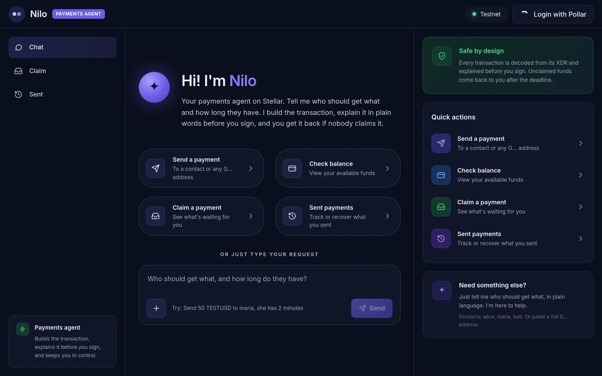
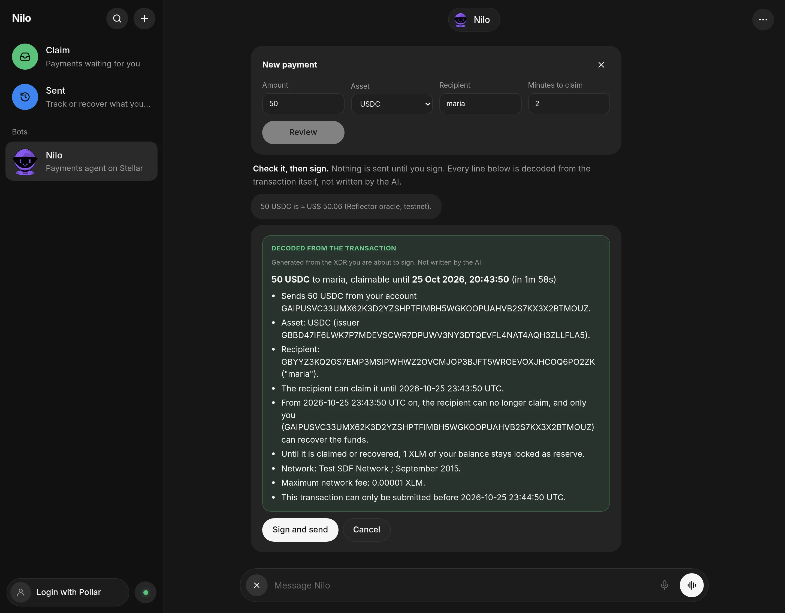
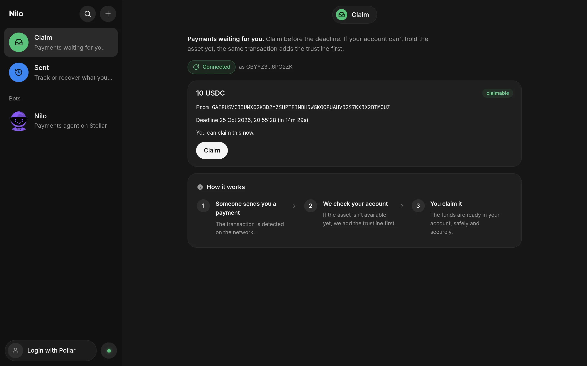
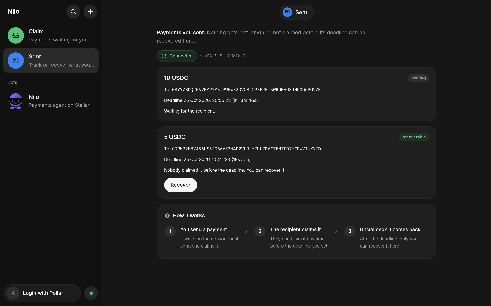
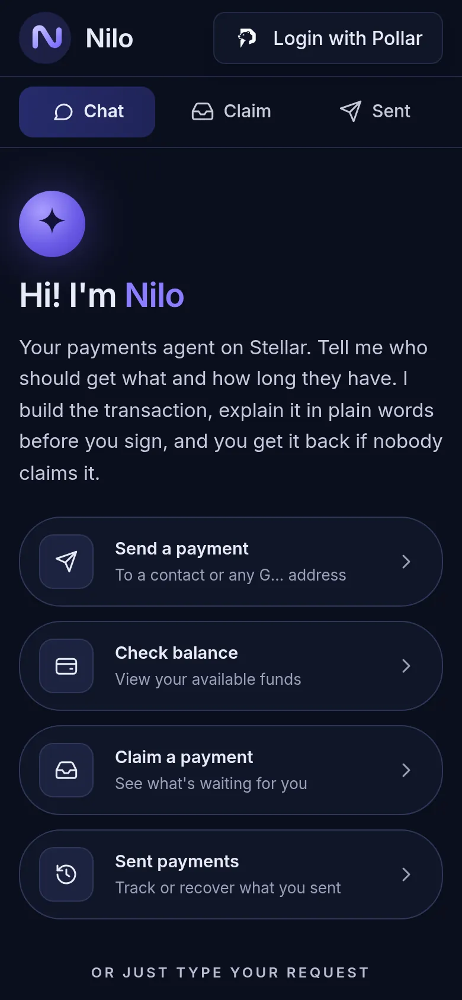

# Nilo

**Your money works while you sleep.**

[nilo-ai.xyz](https://nilo-ai.xyz) · HackMeridian 2026 · Stellar · **testnet only**

Nilo is an investing agent on Stellar. It learns your investor profile, suggests a plan that fits it, and keeps your
USDC invested inside limits you signed, even when you are offline. Nilo never holds your key: you sign one mandate,
and a Soroban contract enforces it on every move.

Nilo started as a chat wallet for payments that can't get lost, and that part is still here: every payment is a
recoverable claimable balance, and before you sign anything Nilo explains the transaction from its own bytes.



## Contents

- [How investing works](#how-investing-works)
- [The mandate contract](#the-mandate-contract)
- [Payments that can't get lost](#payments-that-cant-get-lost)
- [Why you can trust what you sign](#why-you-can-trust-what-you-sign)
- [Prices from Reflector](#prices-from-reflector)
- [Quick start](#quick-start)
- [Try the demo](#try-the-demo)
- [Repository layout](#repository-layout)
- [Limits of v1](#limits-of-v1)

## How investing works

1. **Find your profile.** On first sign-in you answer a short questionnaire (time horizon, finances, market
   knowledge and more). Each answer scores 1, 3 or 5 points, and the total places you as Conservative (up to 12),
   Moderate (up to 22) or Aggressive (above 22). The profile is saved per wallet address in your browser.
2. **Pick a personality.** Each profile maps to a preset, so you don't have to write your own rules:

   | Personality | Profile | Split | Weekly limit | Always kept in wallet |
   |---|---|---|---|---|
   | Guardian | Conservative | 100% XOXNO Lending on Stellar | 50 USDC | 5 USDC |
   | Balanced | Moderate | 60% XOXNO, 40% Aave on Arbitrum via Circle CCTP | 100 USDC | 5 USDC |
   | Explorer | Aggressive | 30% XOXNO, 70% Aave on Arbitrum via Circle CCTP | 250 USDC | 2 USDC |

   Venues the deployment can't reach yet are dropped from the mandate. On the current testnet deployment that
   means XOXNO Lending only; the CCTP leg is wired once its destination vault is deployed.
3. **Sign the mandate once.** On the **Agent** page you sign a mandate (weekly cap, allowed venues, expiry, 30 days
   by default) and a USDC allowance to the NiloAgent contract that covers that period. That is the only signature
   the agent needs.
4. **Nilo invests while you sleep.** The server checks every wallet with a mandate on a schedule
   (`AGENT_INTERVAL_MINUTES`, every 60 minutes by default) and splits your available USDC across the allowed venues
   by the personality's weights, always leaving your reserve in the wallet.
5. **Check in when you are back.** The Agent page shows what is invested, what it has earned, what is in your
   wallet and the XOXNO rate, plus "While you were away", the log of what the agent did.
6. **Withdraw or revoke at any time.** Withdrawals go straight to your wallet. Revoking ends the mandate and zeroes
   the allowance; existing positions stay withdrawable.

## The mandate contract

[`contracts/soroban/nilo-agent`](contracts/soroban/nilo-agent) is what makes "invest on my behalf" safe without
custody. Testnet contract: `CC4VU642T2Z4IEGANZV4HUIEQDOWP2YONA6AFX53WUHNYGZ5VZTZQTR7`.

| Rule | How the contract enforces it |
|---|---|
| Only you set the rules | `set_mandate` and `revoke` require your signature. |
| The operator can only invest | Nilo's operator key can call `invest`, `withdraw` and `renew`, nothing else. |
| Only approved venues | `invest` refuses any venue not in your mandate's bitmask (XOXNO Lending, or CCTP to Nilo's vault). |
| Inside the caps | Each period's total is checked against your limit; going over fails with `OverLimit`. |
| It expires | After `expires_at` the agent can no longer invest. |
| Withdrawals only pay you | `withdraw` can be called by you or the operator, and XOXNO pays the USDC straight to your address. |

Nilo's operator key (`NILO_OPERATOR_SECRET`) lives on the server only. Even if it leaked, the contract would only
let it move your USDC into your own positions, within your caps, and back to you.

## Payments that can't get lost

Type "send 50 USDC to maria, she has 2 minutes" and Nilo sends it as a claimable balance. Maria can claim it before
the deadline. After the deadline, only you can take it back. If you typed the wrong address, the money comes home.
No smart contract, no escrow service, no custody.

### How a payment flows

1. **You write** "send 50 USDC to maria, she has 2 minutes".
2. **The chat agent (LLM)** turns the sentence into four fields:
   `{amount: "50", asset: "USDC", recipient: "maria", deadlineSeconds: 120}`. If a field is missing or
   ambiguous, it asks instead of guessing.
3. **Nilo validates** the intent with deterministic code: address, allowed asset, at most 7 decimals, and a balance
   that covers the amount plus the 1 XLM reserve.
4. **Nilo builds** a `createClaimableBalance` transaction (XDR).
5. **Nilo explains** it: the XDR is decoded into a fixed-template sentence and checked against what you asked for.
   You read, for example: "Sends 50 USDC to GBYY…O2ZK (maria). Claimable until 13:26 UTC, then only you can
   recover it."
6. **You sign** in your wallet (via Pollar), and the wallet submits the transaction to Stellar testnet.

The explanation step accepts only the exact shape Nilo builds. An extra operation, a third claimant, swapped
deadlines, a memo or a recovery path to someone else all produce **"Do not sign"** instead of a best-effort summary.

### The recovery rule

Each payment is one claimable balance with two time predicates that share the same instant `T`. A payment ends in one of two ways:

- **Claimed:** the recipient claims it before `T`.
- **Recovered:** `T` passes unclaimed, and the sender claims it at or after `T`.

| Claimant | Predicate | Meaning |
|---|---|---|
| Recipient | `before_absolute_time(T)` | Can claim while the ledger time is before `T` |
| Sender | `not(before_absolute_time(T))` | Can claim from `T` on |

Two details worth knowing:

- **Trustline on claim.** If the recipient's account can't hold the asset yet, the claim transaction adds the
  trustline first: `changeTrust` + `claimClaimableBalance`, signed once, applied atomically.
- **Claiming is free for the recipient.** Nilo's sponsor account is the source of the claim transaction, so it pays
  the fee, and it sponsors the trustline's 0.5 XLM reserve with `beginSponsoringFutureReserves` /
  `endSponsoringFutureReserves`. The recipient only signs; their XLM balance does not change. If the sponsor is
  unavailable, the app falls back to a claim the recipient pays for.
- **Reserve.** While a payment is pending, 1 XLM of the sender's balance is locked (0.5 XLM per claimant). It is
  released when the balance is claimed or recovered.

Deadlines run from 60 seconds to 30 days. A built transaction stays valid for 180 seconds.

## Why you can trust what you sign

| Guarantee | How |
|---|---|
| The model never sees keys or builds transactions | It receives only the chat text (or, in voice mode, the speech) and returns a schema-validated intent. |
| On-chain data can't inject instructions into the model | The model never reads memos, asset names or anything else from the ledger. |
| The explanation matches the transaction | It is generated from the final XDR by fixed templates, then compared field by field with the validated intent. A mismatch blocks signing. |
| Nilo never holds your funds or keys | Signing happens in the user's wallet: Freighter or Albedo, or a Pollar email/Google wallet. The app only knows users' public addresses. |
| The sponsor only signs what it built | The server rebuilds each sponsored claim from the balance ID, checks on Horizon that you are the recipient and the deadline hasn't passed, then signs. It never signs XDR sent by the browser, and the explainer accepts the sponsored shape only from Nilo's own sponsor account. |

This is what you read before signing "50 USDC to maria, 2 minutes". Every line comes from the transaction bytes;
the "≈ US$" value above it comes from the oracle and is not part of the transaction:



## Prices from Reflector

Nilo also reads live prices from [Reflector](https://reflector.network), Stellar's SEP-40 price oracle, so you can:

- **Ask for a price.** "How much is XLM in BRL?" or "quanto está o bitcoin em reais?"
- **Send in money.** "Send R$ 5 in XLM to maria, she has 2 minutes" converts reais to XLM before the review.
- **See values.** Balances and the review show an "≈ US$" value next to each amount.

The rule from payments still holds: **the model never produces a number.** It only extracts the asset, the currency and
the amount as typed. The price comes from a read-only call to the oracle contract (a simulated `lastprice`, so nothing
is signed or paid). The conversion uses bigint math and rounds down to 7 decimals, so a payment is never worth more
than you asked for. Prices older than 15 minutes are refused.

The conversion is shown on the review with its rate, oracle and time, but it is **not part of the transaction**. What
you sign is the asset amount, explained from the XDR as before.

| Reflector oracle (testnet) | Contract | Used for |
|---|---|---|
| External CEX/DEX prices, in USD | `CCYOZJCOPG34LLQQ7N24YXBM7LL62R7ONMZ3G6WZAAYPB5OYKOMJRN63` | XLM, BTC, ETH, USDC… |
| Foreign exchange, in USD | `CCSSOHTBL3LEWUCBBEB5NJFC2OKFRC74OWEIJIZLRJBGAAU4VMU5NV4W` | BRL, EUR, GBP… |

## Quick start

**You need:** Node.js 20+, a [Pollar](https://pollar.xyz) testnet app and an OpenAI API key.

1. Install and create your env file:

   ```bash
   npm install
   cp .env.example .env
   ```

2. Fill in `.env`:

   | Variable | Where it comes from |
   |---|---|
   | `OPENAI_API_KEY` | OpenAI. Used only by the chat and voice endpoints; the form (the **+** button next to the chat box) works without it. |
   | `OPENAI_MODEL` | Optional. Defaults to `gpt-5.4-mini`. |
   | `OPENAI_VOICE_BACKEND_MODEL`, `OPENAI_VOICE` | Optional, for voice mode (GPT-Live, needs a paid API tier). The model that turns speech into a send or price request defaults to `OPENAI_MODEL`; the voice to `marin`. |
   | `VOICE_ALLOWED_ADDRESSES` | Optional. Voice mode is for signed-in wallets, which sign a message once (SEP-53) so the server can tell who opens sessions on its key. Set comma-separated G… addresses to allow only those wallets, e.g. the presenter's during a demo. |
   | `VITE_POLLAR_API_KEY` | Pollar dashboard → Build → API Keys → **publishable** key (`pub_testnet_…`). Never use a secret key here: `VITE_*` values are shipped to the browser. |
   | `NILO_OPERATOR_SECRET` | Optional, server-side only. Testnet key of Nilo's operator, the only key the NiloAgent contract lets call `invest`. Without it the scheduled agent doesn't start. `AGENT_INTERVAL_MINUTES` (default 60) and `DATA_DIR` (default `data`) are optional. |
| `SPONSOR_SECRET` | Written for you by step 4. Testnet secret of the account that pays claim fees and trustline reserves. Server-side only. |

3. In the Pollar dashboard, add `http://localhost:5173` as an allowed origin and redirect URI, and make sure the app
   has credits for wallet creation.

4. Create the demo accounts and the sponsor account, and give alice Circle's testnet USDC from the
   [Sozu Faucet](https://faucet.sozu.capital). The demo secrets are written to `.env.demo`, and `SPONSOR_SECRET`
   to both `.env` and `.env.demo`:

   ```bash
   npm run setup:testnet
   ```

   Already set up before sponsored claims existed? Create just the sponsor, without touching the demo accounts:

   ```bash
   npm run setup:sponsor
   ```

   Set up when the demo still used TESTUSD? Give alice a USDC trustline and 100 USDC from the faucet:

   ```bash
   npm run setup:usdc
   ```

5. Check the core, then start everything:

   ```bash
   npm test        # core tests
   npm run dev     # API on :8787, web app on http://localhost:5173
   ```

## Try the demo

The demo uses the nicknames `alice` (sender), `maria` (recipient) and `bob`, all created by `setup:testnet`.

| Step | What to do | What you should see |
|---|---|---|
| 1. Send | On **Chat**, type "send 50 USDC to maria, she has 2 minutes" (or click **Send a payment** to fill it in). | An explanation card naming Maria's address and the deadline. |
| 2. Sign | Sign with your wallet. | The payment shows up as pending on **Sent**. |
| 3. Claim | As the recipient, open **Claim** before the deadline. | The explanation says Nilo's sponsor pays the fee and the trustline reserve. The balance is claimed and Maria's XLM is unchanged. |
| 4. Recover | Send to an address nobody controls, wait for the deadline, open **Sent**. | A **Recover** action that returns the funds to you. |

The **Claim** page, as the recipient sees it. It refreshes on its own, so a new payment shows up without a reload:



The **Sent** page, as the sender sees it. A payment waits for the recipient until its deadline; once the deadline
passes unclaimed, it turns recoverable:



Helper scripts:

| Command | What it does |
|---|---|
| `npx tsx scripts/smoke-testnet.ts` | End-to-end check against testnet without a wallet: send → claim with trustline, then send to a stranger → wait → recover. Needs `.env.demo`. |
| `npx tsx --env-file=.env scripts/smoke-sponsored.ts` | End-to-end check of a sponsored claim: maria (no trustline) claims while her XLM stays the same, and the server refuses a stranger and the sender. Needs `SPONSOR_SECRET`. |
| `npm run setup:sponsor` | Creates (or replaces) the sponsor account and writes `SPONSOR_SECRET`. |
| `npm run setup:usdc` | Adds alice's USDC trustline if missing and claims 100 USDC from the Sozu Faucet (it has its own cooldown). |
| `npm run demo:reset-maria` | Resets the recipient account between takes: her USDC goes back to alice and her trustline is removed. |

<details>
<summary>On a phone</summary>



</details>

## Repository layout

| Path | What it does |
|---|---|
| [`packages/core`](packages/core) | Pure TypeScript, no UI: intent schema, validation, transaction builder, XDR explainer, predicate evaluation, price math. All the tests live here. |
| [`apps/server`](apps/server) | Four endpoints. `POST /api/extract`: chat messages in, a structured send intent, price question or clarifying question out. `POST /api/sponsor-claim`: balance ID and claimant in, a claim signed by the sponsor out. `POST /api/faucet`: an address in, 100 test USDC from the Sozu Faucet, rate-limited per account (1/day), per IP (3/day), per server (20/hour), one at a time, and paused while Sozu says it is out or cooling down. `POST /api/voice/session`: a WebRTC SDP offer and a SEP-53 proof of wallet ownership in, the SDP answer of a GPT-Live voice session out, rate-limited per wallet (10/hour) and per server (60/hour). Nothing is built or signed there: the browser shows the usual review. |
| [`apps/web`](apps/web) | Vite + React. **Chat** (send by chat or form, check balance, ask for a price), **Agent** (profile, mandate, positions), **Claim** (recipient), **Sent** (sender recovers). Login and signing through Pollar. Works on phones too. |
| [`contracts/soroban/nilo-agent`](contracts/soroban/nilo-agent) | The NiloAgent Soroban contract: mandates, caps, venues, invest, withdraw and revoke, with its tests. |
| [`apps/server/src/agent`](apps/server/src/agent) | The scheduled agent that reads each mandate and invests with the operator key. |
| [`scripts/`](scripts) | Testnet and sponsor setup, the wallet-free smoke tests, and the demo reset. |

## Limits of v1

- Testnet only. The allowed assets are XLM and Circle's testnet USDC (`GBBD47…LFLA5`).
- Recipients are a full `G…` address or a nickname from a fixed demo list (`alice`, `maria`, `bob`).
- The recipient needs an existing Stellar account. It doesn't need spare XLM: Nilo sponsors the fee and the
  trustline reserve. Sponsoring account creation (`createAccount` with a 0 starting balance) is not done yet.
- One sponsor account, with no rate limit beyond "one claim per balance". That's fine on testnet, but it would need
  limits before mainnet.
- Passkey smart wallets (`C…` addresses) are not supported: claimable balances are classic operations.

